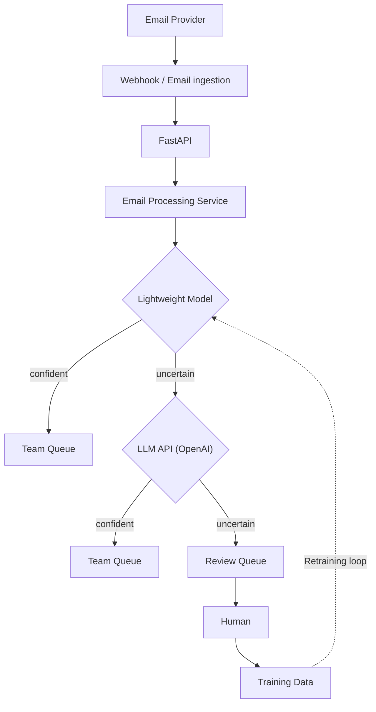

# Basic Email Ingestion & Routing System

A minimal, readable implementation of the email routing flowchart.

## Architecture



## How It Works

1. **Lightweight Model**: Fast rule check for clear, repetitive keywords (e.g. "refund", "invoice").
   - If confident ➔ Routes directly to **Team Queue** (skipping LLM entirely).
   - If uncertain ➔ Escalates to **LLM API**.
2. **LLM API (OpenAI API)**: Classifies nuanced emails with confidence scoring.
   - If confident ➔ Routes to **Team Queue**.
   - If uncertain ➔ Sends to **Review Queue**.
3. **Human Review**: Operator reviews uncertain emails, selects the correct team queue, and clicks **Assign & Save**.
4. **Training Data**: Approved decisions are added to the training dataset for future retraining.

## Quick Start

Run both servers with a single command:
```bash
cd /Users/charansriteja/.gemini/antigravity/scratch/email-routing-system
./start.sh
```

- **Frontend**: `http://localhost:5173`
- **Backend API**: `http://localhost:8000`
- Press `Ctrl+C` in your terminal to shut down both servers cleanly.

Open: **`http://localhost:5173`**
